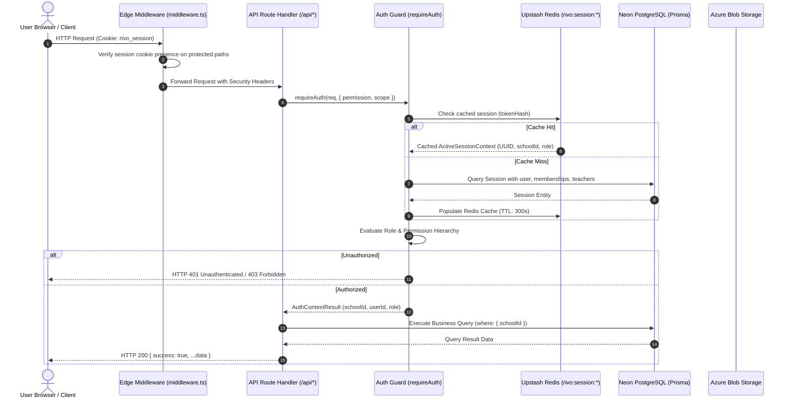
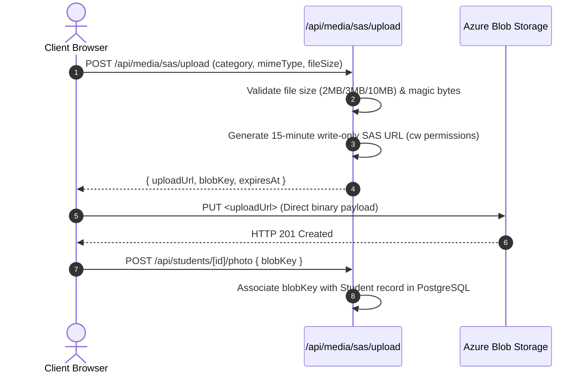

# RIVO — System Architecture Specification

> **Last Verified:** November 11, 2026  
> **Status:** Code-Verified Architectural Blueprint  
> **Scope:** Full-Stack Monolith, Edge Gateway, Data Tier, Storage, and Microservices

---

## 1. System Topology & Architecture Overview

Rivo is architectured as a **cloud-native, multi-tenant Full-Stack Monolith** powered by **Next.js 16 (App Router)** and **React 19**, running on **Vercel Serverless Edge Platform** backed by **Neon Serverless PostgreSQL**, **Upstash Redis**, **Azure Blob Storage**, and **Resend Transactional Email**.

```mermaid
flowchart TD
    Client["Client Devices\n(Admin Browser, Teacher Web, Mobile Parent PWA/Flutter)"] --> VercelEdge["Vercel Global Edge Network"]

    subgraph Edge_Security ["Edge Layer (apps/web/src/middleware.ts)"]
        VercelEdge --> EdgeGuard["Edge Middleware Guard\n- Session Cookie Verification\n- Route Protection (/school, /teacher, /parent)\n- Security Headers (DENY, nosniff)"]
    end

    subgraph Web_Monolith ["Full-Stack Monolith (apps/web)"]
        EdgeGuard --> AppRouter["Next.js 16 App Router Engine"]
        AppRouter --> ReactTree["React 19 Server/Client Components\n- /(school) Admin Cockpit\n- /(teacher) Faculty Portal\n- /(parent) Parent Self-Service\n- /testing-center Observability"]
        AppRouter --> RouteHandlers["API Route Handlers (/api/*)\n- 30+ Domain Routes\n- 74+ Production Endpoints"]
        RouteHandlers --> DomainServices["Domain Service Layer (src/lib)\n- fee-payment-service.ts\n- roll-number-service.ts\n- conflict-engine.ts\n- azure-blob.ts\n- resend.ts"]
    end

    subgraph Data_Tier ["Cloud Data & Storage Layer"]
        DomainServices -->|"DATABASE_URL (Port 6543 / PgBouncer)"| NeonPooler["Neon PostgreSQL (Pooled)"]
        NeonPooler --> NeonDB[("Neon Primary PostgreSQL Database\n(67 Models, 30 Enums)")]
        DomainServices -->|"REDIS_URL (TLS rediss://)"| UpstashRedis[("Upstash Redis\n- Session Cache\n- Sliding-Window Rate Limiter")]
        DomainServices -->|"Direct Upload SAS (15m)"| AzureStorage[("Azure Blob Storage\n- rivo-public (Logos)\n- rivo-private (KYC, Documents)")]
        DomainServices -->|"RESEND_API_KEY"| ResendAPI["Resend Email API"]
    end

    subgraph CI_CD ["CI/CD & DDL Runner"]
        GitHubActions[".github/workflows/ci.yml"] -->|"DIRECT_URL (Port 5432)"| NeonDirect["Neon Direct Host (DDL & Migrations)"]
        NeonDirect --> NeonDB
    end

    subgraph Scaffold ["Scaffold / Future Microservices"]
        NestApp["NestJS Scaffold (apps/api - Port 4000)"]
    end
```

---

## 2. Application Boundaries & Workspace Topology

### 2.1 Workspace Allocations
1. **`apps/web` (The Authoritative Production Monolith):**
   - Houses both the complete frontend client interfaces and all production backend API routes.
   - Collocates presentation logic with direct Prisma ORM queries, Redis caching, and domain services.
   - Deployed as serverless edge lambdas on Vercel (`rivo-web`).
2. **`apps/api` (Prototype NestJS Microservice):**
   - Standalone NestJS 12 scaffold containing a health controller and a database service.
   - Not active in production deployment.
3. **`apps/parent` (Native Flutter Client):**
   - Flutter 3.x / Dart mobile app connecting directly to `apps/web/src/app/api` endpoints.
4. **`packages/*` (Reserved Monorepo Workspaces):**
   - `packages/config`, `packages/types`, and `packages/validation` are reserved for future monorepo package extraction. Active code lives in `apps/web`.

---

## 3. Request Lifecycle & Authentication Flow

---

## 4. Multi-Tenant Isolation Architecture

1. **Row-Level Tenancy (`schoolId`):**
   - 38 Core domain models enforce a mandatory, non-nullable `schoolId String` foreign key.
   - Child sub-resources inherit isolation through parent foreign keys (`AttendanceRecord -> AttendanceRegister`, `FeePaymentAllocation -> FeePayment`).
2. **Compound Unique Constraints:**
   - Database uniqueness is strictly scoped to the tenant:
     - `@@unique([schoolId, admissionNumber])` (Students)
     - `@@unique([schoolId, employeeId])` (Teachers)
     - `@@unique([schoolId, code])` (Fee Heads, Fee Plans)
     - `@@unique([schoolId, name])` (Classes, Campuses, Academic Sessions)
3. **Dual PostgreSQL Connection Strategy:**
   - **Runtime Pooling (`DATABASE_URL`):** Connects to Neon PgBouncer on port 6543 to pool serverless connections.
   - **Migration DDL (`DIRECT_URL`):** Connects directly to PostgreSQL on port 5432 to allow Prisma CLI advisory locks during migrations.

---

## 5. Storage Architecture (Direct-to-Cloud SAS)

- **Zero-Filesystem Execution:** Direct client browser uploads bypass Vercel execution timeouts and memory limits.
- **Container Separation:**
  - `rivo-public`: Anonymous public CDN read for school crests and logos.
  - `rivo-private`: Zero anonymous access. Scoped by tenant: `schools/{schoolId}/{category}/{entityId}/{hash}.ext`.

---

## 6. Financial Ledger & Idempotency Architecture

1. **Immutable Fee Plan Versioning:**
   - Published fee plans (`FeePlanVersionStatus.PUBLISHED`) are permanently locked against modifications.
   - Plan edits branch a new version (`v2`), preserving historical obligations and payments.
2. **Double-Entry Fee Payment Allocations:**
   - Collections generate an atomic transaction linking payments (`FeePayment`) to installment obligations (`FeeObligation`) via allocation records (`FeePaymentAllocation`).
3. **Non-Destructive Reversals:**
   - Erroneous or bounced payments are rolled back transactionally. The payment is flagged as `REVERSED`, the receipt cancelled, and the obligation balance restored.
4. **Serverless Vector PDF Generation:**
   - `pdf-lib` renders receipts entirely in memory on Vercel serverless lambdas with zero headless browser overhead.

