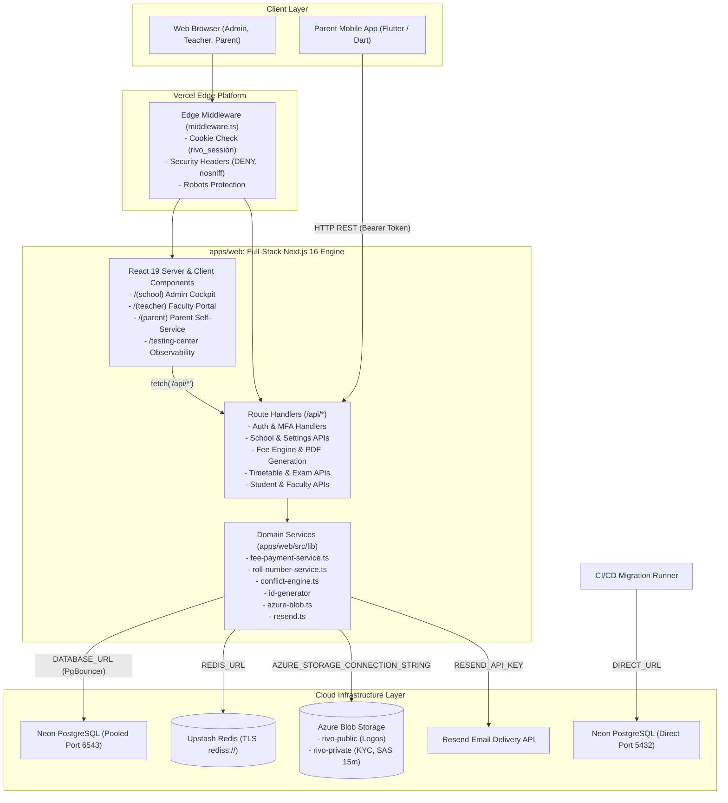

# RIVO — Master Project Context & AI Permanent Knowledge Base

> **Document Status:** Authoritative Master Knowledge Base  
> **Last Verified Date:** November 11, 2026  
> **Target Audience:** Engineering Leads, Senior Architects, Full-Stack Developers, and Autonomous AI Coding Agents  
> **Primary Purpose:** Instant, complete context restoration for any developer or AI resuming RIVO development after months of inactivity.

---

## 1. Project Identity and Purpose

- **Name:** Rivo
- **Identity:** School Operating System & Multi-Tenant Digital ERP Ecosystem
- **Purpose:** Rivo is a specialized SaaS platform designed to digitize end-to-end school operations for K-12 private and independent educational institutions. It replaces disjointed spreadsheets, paper registers, and clunky legacy software with a unified, high-performance web and mobile platform.
- **Primary Stakeholders:**
  1. **School Leadership & Management:** Directors, Trustees, Principals, Administrators, and Financial Officers who require operational oversight, fee collection, staff compliance, and academic governance.
  2. **Faculty & Staff:** Teachers who manage daily roll-call attendance, class timetables, examination marks tabulation, and student KYC verification.
  3. **Parents & Guardians:** Families who track academic progress, view circulars, receive notices, monitor fee obligations, and download verified payment receipts.
  4. **Platform Operators:** Rivo platform super-administrators who monitor institutional health, manage multi-tenant lifecycle, and diagnose system telemetry.

---

## 2. Product Vision

The long-term vision of Rivo is to become the default institutional operating system for educational institutions across emerging and developed markets. Rather than attempting to force schools into rigid, generic enterprise software, Rivo models the actual ground reality of school administration:
- Complex multi-installment fee structures with concessions and cash/cheque/UPI reconciliations.
- Dynamic student intake with customizable prefixes, alphabetical roll number rebalancing, and document archives.
- Timetable scheduling with automatic collision detection across teachers, cohorts, and physical venues.
- Communication architectures that respect local channels (WhatsApp-first, in-app push, with SMS as an emergency OTP fallback).

---

## 3. Current MVP Scope & Priorities

### Development Priority: SCHOOL / ADMIN MANAGEMENT SIDE
- **Strict MVP Focus:** The current development priority is the **School / Admin Management OS (`apps/web/src/app/(school)/school/*`)**.
- **Parent & Student Freezing:** Existing parent web (`/parent`) and mobile (`apps/parent`) views are functionally sufficient for the initial launch phase. **Do not expand parent/student features or initiate UI redesigns** until the admin management product is launched and stabilized in production.
- **Fee Management Priority:** Fee heads, annual versioned plans, obligations generation, payment collection, and instant serverless receipt PDF generation represent the core commercial foundation of the product.

---

## 4. Important Business Decisions

1. **WhatsApp-First Communication:** Rivo deliberately avoids building expensive proprietary chat infrastructure to replace WhatsApp. Instead, in-app push notifications and transactional email (Resend) form the low-cost baseline, while WhatsApp is treated as a high-priority external paid delivery channel and quick-share mechanism.
2. **Deterministic Financial Ledger (No Silent Edits):** Once an annual fee plan is published, it becomes permanently immutable. Adjustments require explicit draft version increments (`FeePlanVersion`). Payments can never be deleted—only transactionally reversed with an auditable reason, preserving financial accounting integrity.
3. **Double-Entry Fee Allocations:** Payments are allocated directly to individual installment obligations (oldest-due first or manual assignment). Overpayments are rejected; receipts are legally locked snapshots.
4. **Tenant Isolation Over Multi-Database Sharding:** A single PostgreSQL cluster with strict row-level `schoolId` foreign keys and composite unique indexes is utilized, drastically reducing operational costs while preserving complete tenant data isolation.

---

## 5. Current Technical Stack (Verified from Source)

| Layer | Technology | Version | Key Package / Implementation Details |
| :--- | :--- | :--- | :--- |
| **Monorepo Engine** | npm Workspaces | npm v10+ (lockfile v3) | `apps/web`, `apps/api`, `packages/*` |
| **Full-Stack Monolith** | Next.js (App Router) | **16.3.5** | `apps/web` (SSR, React Server Components, Route Handlers) |
| **UI Framework** | React / React DOM | **19.2.8** | Client & Server Components, hooks, context |
| **Styling & Design** | Tailwind CSS | **v4.0.0** | `@tailwindcss/postcss`, `@import "tailwindcss"`, CSS variables |
| **Motion Physics** | Motion (Framer Motion) | **14.0.0** | `import { motion, AnimatePresence } from 'motion/react'` |
| **UI Primitives** | Custom Headless Primitives | — | Custom accessible components in `apps/web/src/components/ui/` |
| **Icons & Toasts** | Lucide React & Sonner | **lucide-react: 1.47.0**, **sonner: 2.0.8** | Vector iconography and notification toasts |
| **Database ORM** | Prisma ORM | **6.19.3** | PostgreSQL driver, multi-tenant relational schema |
| **Database Hosting** | Neon Serverless PostgreSQL | — | Pooled connection (PgBouncer: 6543) + Direct connection (5432) |
| **Distributed Cache** | Upstash Redis / Redis | **ioredis: 6.0.0** | Distributed rate limiting, session cache, token bucket |
| **Cloud Storage** | Azure Blob Storage | **@azure/storage-blob: 12.34.0** | Direct-to-browser SAS tokens (15m), public/private buckets |
| **Email Delivery** | Resend API | **resend: 6.28.1** | Transactional staff invitations, password reset dispatch |
| **PDF Generation** | PDF-Lib | **pdf-lib: 1.17.1** | Pure JavaScript serverless A4 fee receipt PDF generation |
| **Authentication** | Custom Cryptographic Auth | — | `scrypt` hashing, SHA-256 token hashing, AES-256-GCM |
| **MFA Engine** | OTPAuth & QRCode | **otpauth: 9.5.2**, **qrcode: 1.5.4** | RFC 6238 TOTP engine, encrypted secrets, recovery codes |
| **Mobile Client** | Flutter / Dart | **SDK: >=3.0.0 <4.0.0** | `apps/parent` (Flutter 3.x, Riverpod 2.5, Dio 5.4, GoRouter 14) |
| **Backend Prototype** | NestJS | **12.0.1** | `apps/api` (scaffolded health microservice prototype) |

---

## 6. Complete Repository Structure

```
d:/Rivo/
├── .agents/                      # Agent skills configuration (neon, neon-postgres, rivo-ui-motion)
├── .github/                      # CI/CD Workflows
│   └── workflows/ci.yml          # GitHub Actions CI pipeline (Node 20, Prisma, Lint, 9 Test Suites, Build)
├── .vercel/                      # Vercel deployment link configuration (Project: rivo-web)
├── apps/
│   ├── web/                      # [PRIMARY FULL-STACK APP] Next.js 16 + React 19 + API Monolith
│   │   ├── src/
│   │   │   ├── app/              # App Router Pages & API Route Handlers
│   │   │   │   ├── (auth)/       # Auth pages (login, signup, forgot-password, reset-password, invite)
│   │   │   │   ├── (parent)/     # Parent portal views (fees, notices, results, profile)
│   │   │   │   ├── (school)/     # School Admin OS (students, teachers, fees, attendance, timetable, settings)
│   │   │   │   ├── (teacher)/    # Faculty workspace (dashboard, attendance, classes, timetable, documents)
│   │   │   │   ├── access-denied/# 403 Forbidden boundary page
│   │   │   │   ├── admin/        # Platform admin area (redirects to testing-center)
│   │   │   │   ├── api/          # 30+ domain route handlers (74+ production endpoints)
│   │   │   │   ├── testing-center/# Dedicated testing & live observability platform
│   │   │   │   ├── layout.tsx    # Root layout (AuthProvider, Geist fonts)
│   │   │   │   └── page.tsx      # Root redirect (/ -> /login)
│   │   │   ├── components/       # UI Primitives, Layouts, Navigation, Auth Guards
│   │   │   ├── features/         # Feature components (classes, teachers, homework, timetable, settings)
│   │   │   ├── lib/              # Core business services (auth, fees, id-generator, storage, testing)
│   │   │   ├── shared/           # Entity selectors, mock store, validation engines
│   │   │   ├── types/            # Active TypeScript interfaces and type definitions
│   │   │   ├── __tests__/        # 27 integration and forensic test suites
│   │   │   └── middleware.ts     # Edge security guard (cookie verification, headers)
│   │   ├── next.config.ts        # Next.js 16 configuration
│   │   ├── package.json          # Web dependencies and scripts
│   │   └── tsconfig.json         # Web TypeScript configuration
│   ├── api/                      # [PROTOTYPE] NestJS 12 Microservice Scaffold (Health check only)
│   └── parent/                   # [MOBILE APP] Flutter 3.x Native Parent Application
├── packages/                     # [WORKSPACE PLACEHOLDERS]
│   ├── config/README.md          # Reserved for monorepo tooling
│   ├── types/README.md           # Reserved for shared types (active types in apps/web/src/types)
│   └── validation/README.md      # Reserved for shared validation (active in apps/web/src/lib/validation)
├── prisma/
│   ├── migrations/               # 14 Chronological PostgreSQL schema migrations
│   ├── schema.prisma             # 67 Models, 30 Enums, Multi-Tenant Relational Schema
│   └── seed.ts                   # Database seed script (Platform Owner, Greenwood Academy, Roles)
├── infrastructure/               # DevOps documentation, runbooks, and policies
├── docs/                         # Centralized Documentation & Permanent Knowledge System
├── AGENTS.md                     # Agent Operating System & Quick Context Recovery Guide
└── package.json                  # Root monorepo workspace configuration & test scripts
```

---

## 7. High-Level System Architecture



---

## 8. Applications and Their Responsibilities

1. **`apps/web` (Next.js 16.3.5 / React 19.2.8):**
   - The authoritative production monolith.
   - Serves the School Admin OS, Teacher Portal, Web Parent Portal, Auth Flows, and the Testing Center.
   - Hosts all 74+ production API route handlers under `apps/web/src/app/api`.
2. **`apps/api` (NestJS 12.0.1):**
   - Experimental microservice prototype scaffold.
   - Contains NestJS boilerplate, `PrismaService`, and `HealthController`.
   - **Not deployed to production.**
3. **`apps/parent` (Flutter 3.x / Dart):**
   - Companion native mobile client for parents.
   - Connects to `apps/web/src/app/api` endpoints.
   - Implements OTP login, notice board, notification stream, profile switcher, and terminal report card views.

---

## 9. Important Backend Modules (`apps/web/src/lib`)

- **`lib/auth`:** Database-backed sessions with SHA-256 hashed tokens, Redis caching, Scrypt password hashing, TOTP MFA engine with single-use recovery codes, and deterministic role hierarchy guards (`requireAuth`).
- **`lib/fees`:** Complete financial ledger engine. Supports fee plan creation, versioning, cohort assignment, obligation generation, payment allocation (FIFO or targeted), payment reversals, concession reversals, and vector PDF receipt generation via `pdf-lib`.
- **`lib/id-generator`:** Race-condition-free sequential identifier generator using PostgreSQL atomic counters (`IdSequence`). Derives institutional prefixes, handles zero-padding, and integrates Redis and in-memory caching.
- **`lib/students`:** Student intake lifecycle, document attachments, guardian relationship binding, and Unicode-normalized alphabetical roll number balancing.
- **`lib/teachers`:** Faculty directory, employee ID generation, KYC document compliance, and granular per-teacher permission overrides (`UserPermissionOverride`).
- **`lib/timetable`:** Real-world conflict detection engine checking teacher double-booking, cohort scheduling collisions, and physical venue availability.
- **`lib/results`:** Formal examination tabulation, CBSE 8-band grading (`A1` to `E`), compartment evaluation, and official publication locking.
- **`lib/storage`:** Azure Blob Storage abstraction with 15-minute write-only browser SAS token generation, magic-byte MIME validation, and in-memory fallback for local development.
- **`lib/testing`:** Automated in-app testing engine with diagnostic probes, synthetic load testing, and metric collection.

---

## 10. Database Architecture Overview

- **Engine:** PostgreSQL managed via Prisma ORM (`prisma/schema.prisma`).
- **Scale:** **67 Models**, **30 Enums**, and **14 Migrations**.
- **Multi-Tenant Isolation:**
  - 38 Core models enforce non-nullable `schoolId String`.
  - Dependent sub-resources inherit isolation transitively via parent foreign keys (`AttendanceRecord -> AttendanceRegister`, `FeePlanItem -> FeePlanVersion`).
  - Platform/Global models (`User`, `Permission`, `TestRun`) have null or omitted `schoolId`.
- **Integrity Safeguards:** Critical financial and enrollment relations strictly enforce `onDelete: Restrict` to prevent cascading deletion of audit logs, payments, and active enrollments.
- **No Generic Soft-Deletes:** Instead of fragile `deletedAt IS NULL` filters, the system uses explicit state machine enumerations (`SchoolStatus.ARCHIVED`, `FeePaymentStatus.REVERSED`, `FeeObligationStatus.CANCELLED`).

---

## 11. Authentication & Authorization Model

```
Request ➔ Edge Middleware (reads 'rivo_session' cookie)
            │
            ▼
    Session Resolution (lib/auth/session.ts)
      ├── 1. Redis Cache Lookup (rivo:session:<tokenHash>)
      ├── 2. PostgreSQL Lookup (with user memberships & teachers)
      └── 3. Validation (revokedAt is null, expiresAt > now, user.status == 'ACTIVE')
            │
            ▼
    Role & Permission Guard (lib/auth/authorize.ts: requireAuth)
      ├── Case 1: DIRECTOR or OWNER ➔ ALLOW ALL (SCHOOL scope)
      ├── Case 2: PRINCIPAL / ADMIN ➔ ALLOW Operational, DENY Security/Roles
      ├── Case 3: UserPermissionOverride (explicit allow/deny per teacher)
      ├── Case 4: CustomRole Permissions (RolePermission junction)
      └── Case 5: System Role Defaults (TEACHER -> ASSIGNED scope)
```

- **Sessions:** Database-backed sessions. Raw 32-byte cryptographically secure random token issued in `rivo_session` cookie; only the SHA-256 hash is stored in PostgreSQL and cached in Redis (5-minute TTL).
- **MFA:** RFC 6238 TOTP with AES-256-GCM encrypted secrets (`MFA_ENCRYPTION_KEY`) and 10 hashed single-use recovery codes.
- **KYC Encryption:** Sensitive field-level PII (Aadhaar, PAN) encrypted at rest using AES-256-GCM (`KYC_ENCRYPTION_KEY`).

---

## 12. API Architecture

All authoritative production APIs are Next.js 16 App Router Route Handlers located in `apps/web/src/app/api`:
- **Standard Envelope:**
  - Success: `{ success: true, ...data }`
  - Error: `{ success: false, message: string, code?: string, errors?: string[] }`
- **Error Codes:** 400 (Bad Request), 401 (Unauthenticated), 403 (Unauthorized / Role Boundary), 404 (Not Found), 409 (Conflict), 415 (Unsupported Media), 422 (Unprocessable), 429 (Rate Limited), 500 (Internal Error).

---

## 13. External Cloud Integrations

1. **Neon Serverless PostgreSQL:**
   - Primary cloud relational database.
   - Pooled connection via PgBouncer on port 6543 (`DATABASE_URL`).
   - Direct connection on port 5432 (`DIRECT_URL`) for advisory locks and schema migrations.
2. **Upstash Redis:**
   - Distributed session caching and sliding-window rate limiting.
   - Connected via `ioredis` with TLS auto-upgrade (`rediss://`).
3. **Azure Blob Storage:**
   - Cloud object storage for school crests (`rivo-public`) and KYC student/teacher records (`rivo-private`).
   - Secure browser-to-cloud uploads via 15-minute write-only SAS tokens.
4. **Resend Transactional Email:**
   - Outbound transactional email delivery for faculty onboarding invitations and password recovery tokens.

---

## 14. Development Environment & Prerequisites

- **Operating System:** Windows, macOS, or Linux.
- **Node.js:** `v20.x` LTS (or `v22.x`).
- **Package Manager:** `npm` v10+ (configured for npm workspaces).
- **Database:** PostgreSQL v15+ (local instance or free cloud Neon branch).
- **Optional Cache:** Redis v6+ (or free Upstash Redis instance).

---

## 15. Installation and Startup Commands

```bash
# 1. Clone repository
git clone <repo-url>
cd rivo

# 2. Install workspace dependencies
npm ci

# 3. Configure environment files
cp .env.example .env.local
cp apps/web/.env.example apps/web/.env.local

# 4. Generate Prisma Client & Validate Schema
npm run prisma:validate
npm run prisma:generate

# 5. Apply Migrations to Local/Dev Database
npm run prisma:migrate:deploy

# 6. (Optional) Seed Demo Institutional Data
npm run db:seed

# 7. Start Development Server (Port 3000)
npm run dev

# 8. Run Verification Test Suite
npm test
```

---

## 16. Current Implementation Status Summary

- **Fully Implemented Core:**
  - School Admin Onboarding & Multi-Tenant Workspace
  - Academic Structure (Sessions, Campuses, Classes, Sections, Streams, Subjects, Houses, Rooms)
  - Student Next ID Generation & 6-Stage Intake Wizard
  - Faculty Directory & Granular Permission Overrides
  - Complete Fee Management System (Heads, Plans, Versioning, Obligations, Payments, Concessions, Reversals, PDF Receipts)
  - Timetable Grid & Exam Scheduling with Conflict Detection
  - Admit Cards & Hall Tickets Print Center
  - Student Daily Roll-Call Attendance
  - Notice Board & Communication Group Audience Targeting
  - Examination Scoring & Publication Lockdown
  - Testing & Observability Center
- **Partially Implemented:**
  - Alphabetical Roll Rebalancing (APIs work; trigger button missing in UI).
  - Teacher Document Verification (Teacher upload works; Admin review tab missing in `/school/teachers/[id]`).
  - Report Card PDF Generation (Browser print works; server-side PDF generator missing).
  - Parent Flutter App (Auth & Results work; Fee ledger view missing).
- **UI Only / Mock:**
  - Student Homework Turn-in (`/api/homework/submit` validates rules but lacks DB model).
- **Not Implemented:**
  - Daily Teacher Attendance.
  - Automated WhatsApp Business Gateway.

---

## 17. Known Bugs and Risks (From Security & Quality Audit)

1. **[CRITICAL] Live Database Credentials Committed to Example Files:**
   - `apps/api/.env.example` and `apps/web/.env.example` contain active Neon database credentials in git history. Credentials must be rotated in the Neon Console immediately.
2. **[CRITICAL] Lost-Update Race Condition in Fee Payments (`fee-payment-service.ts`):**
   - Concurrent payments for the same student under PostgreSQL `READ COMMITTED` isolation can cause lost updates. A distributed Redis lock or atomic SQL increment is required.
3. **[HIGH] IDOR / BOLA on Single Student Profile Endpoint (`/api/students/[id]`):**
   - Teachers with `ASSIGNED` scope can view any student in the school by ID. Scoping check must be added.
4. **[HIGH] Cartesian Product Scoping Leak in Teacher Student Lists (`/api/students`):**
   - Independent `in` filters for `classId` and `sectionId` create a Cartesian product. Must use paired `OR` filters.
5. **[HIGH] RateLimiter Fails Open in Production Mode When Redis is Offline:**
   - In-memory fallback on serverless Lambdas permits brute-force login attempts if Redis drops.
6. **[HIGH] Parent Multi-School Switching Desynchronizes Redis Session Cache:**
   - `/api/auth/parent/select-school` updates PostgreSQL but neglects to invalidate the Redis session cache.
7. **[HIGH] Sonner `<Toaster />` Missing in RootLayout:**
   - 46+ components trigger `toast.success()` / `toast.error()`, but toasts are completely invisible because `<Toaster />` is not mounted.

---

## 18. Technical Debt

1. **1,500-Line In-Memory Mock Store (`school-store.ts`):**
   - Over 27 frontend files still import from `apps/web/src/shared/mock-store/school-store.ts` (using `useSyncExternalStore`) rather than querying real backend APIs.
2. **TypeScript Build Type-Checking Suppressed:**
   - `apps/web/next.config.ts` sets `typescript: { ignoreBuildErrors: true }`. This must be removed to prevent compilation bugs from reaching production.
3. **Zero Next.js Error Boundaries:**
   - No `error.tsx` or `not-found.tsx` files exist in `src/app`. Runtime client errors crash to unstyled overlays.
4. **37 Unindexed Foreign Keys in Prisma Schema:**
   - Audit foreign keys (`collectedByUserId`, `verifiedById`, `updatedById`) lack standalone indexes, creating sequential scan overhead on user updates.

---

## 19. Important Files and Entry Points

| File Path | Description & Role |
| :--- | :--- |
| `apps/web/src/middleware.ts` | Edge security guard, cookie check, security headers |
| `apps/web/src/app/layout.tsx` | Root layout, font injection, `AuthProvider` mounting |
| `apps/web/src/lib/prisma.ts` | Global Prisma singleton and connection manager |
| `apps/web/src/lib/auth/session.ts` | Database session creation, resolution, and caching |
| `apps/web/src/lib/auth/authorize.ts` | Central role and permission verification guard |
| `apps/web/src/lib/fees/fee-payment-service.ts` | Atomic fee payment collection, allocation, and reversal |
| `apps/web/src/lib/fees/fee-pdf-service.ts` | Vector A4 fee receipt PDF generation engine |
| `apps/web/src/lib/id-generator/index.ts` | Sequential institutional identifier generator |
| `apps/web/src/lib/students/roll-number-service.ts` | Alphabetical roll number balancing and collation engine |
| `apps/web/src/lib/storage/azure-blob.ts` | Direct Azure Blob SAS upload and media manager |
| `apps/web/src/components/layout/app-shell.tsx` | School Admin layout shell, sidebar, and command search |
| `prisma/schema.prisma` | Master 67-model relational database schema |

---

## 20. Architecture Decisions Summary

- **ADR-001:** Single Next.js Full-Stack Monolith (`apps/web`) chosen over separated NestJS backend for MVP velocity.
- **ADR-002:** Relational Custom Roles & Permissions (`CustomRole`, `RolePermission`) chosen over JSON settings blobs.
- **ADR-003:** Immutable Fee Plan Versioning with strict payment reversals chosen over mutable ledger entries.
- **ADR-004:** Direct-to-Azure Browser SAS Uploads (15m write-only) chosen to prevent Vercel serverless execution memory exhaustion.
- **ADR-005:** State Machine Enumerations chosen over soft-delete timestamps (`deletedAt`).

---

## 21. Current Development Priorities

1. **Security & Credential Remediation:** Rotate Neon credentials, fix Redis rate-limiter fail-closed behavior, patch IDOR in student detail endpoint.
2. **Frontend Quality Polish:** Mount `<Toaster />` in `RootLayout` so all 46+ toast calls become visible; add basic `error.tsx` boundaries.
3. **Admin Verification UI:** Add the "Documents & Verification" tab to `/school/teachers/[id]` to close the faculty KYC loop.
4. **Roll Balancing Trigger:** Add the "Rebalance Roll Numbers" confirmation dialog to `/school/students`.
5. **Report Card PDF Generation:** Build server-side report card PDF generator using `pdf-lib` modeled after `fee-pdf-service.ts`.

---

## 22. Next Recommended Development Tasks

1. **Task 1 (P0):** Rotate Neon PostgreSQL database credentials and replace secret in `apps/api/.env.example` and `apps/web/.env.example`.
2. **Task 2 (P0):** Fix RateLimiter in `apps/web/src/lib/auth/rate-limiter.ts` to fail closed in production when Redis is unreachable.
3. **Task 3 (P0):** Mount `<Toaster />` from `sonner` in `apps/web/src/app/layout.tsx`.
4. **Task 4 (P1):** Patch student detail authorization in `apps/web/src/app/api/students/[id]/route.ts` to enforce `ASSIGNED` scope for teachers.
5. **Task 5 (P1):** Add Redis distributed lock (`redlock`) around `recordFeePayment` in `fee-payment-service.ts`.
6. **Task 6 (P1):** Invalidate Redis session cache in `apps/web/src/app/api/auth/parent/select-school/route.ts`.
7. **Task 7 (P2):** Add Teacher Document Verification review interface to `apps/web/src/app/(school)/school/teachers/[id]/page.tsx`.
8. **Task 8 (P2):** Connect `roll-rebalance-dialog.tsx` to `/school/students` roster view.
9. **Task 9 (P2):** Migrate legacy entity selectors away from `school-store.ts` to direct API fetch hooks.

---

## 23. Known Limitations and Unresolved Questions

- **Staff Attendance:** Currently, Rivo has no model or API for recording daily staff/teacher attendance.
- **WhatsApp Integration:** No automated webhook gateway exists; messaging relies on manual link generation.
- **Offline Mode:** The web app requires an active internet connection. Offline mutations are not supported.
- **Mobile Parent App Auth:** `apps/parent` sends `Authorization: Bearer <token>`, while `getValidSession` currently checks only cookies.

---

## 24. HOW TO RESUME RIVO DEVELOPMENT (Actionable AI Protocol)

When starting a new development session:
1. **Read Core Files First:**
   - Read `AGENTS.md`.
   - Read `docs/PROJECT_CONTEXT.md` (this file).
   - Read `docs/PROJECT_MANAGEMENT/FEATURE_STATUS.md` and `docs/PROJECT_MANAGEMENT/NEXT_STEPS.md`.
2. **Check Git Status & Uncommitted Work:**
   - Run `git status -s` to inspect dirty files.
   - Run `git log -n 5 --oneline` to review recent commits.
3. **Verify Before Coding:**
   - Inspect target files and their callers.
   - Run `npm run prisma:validate` before modifying schema.
4. **Execute Minimal Changes:**
   - Never refactor surrounding architecture unless explicitly tasked.
   - Follow existing patterns in `apps/web/src/lib/` and `apps/web/src/components/ui/`.
5. **Update Documentation:**
   - Update `FEATURE_STATUS.md` and `NEXT_STEPS.md` upon completing work.

