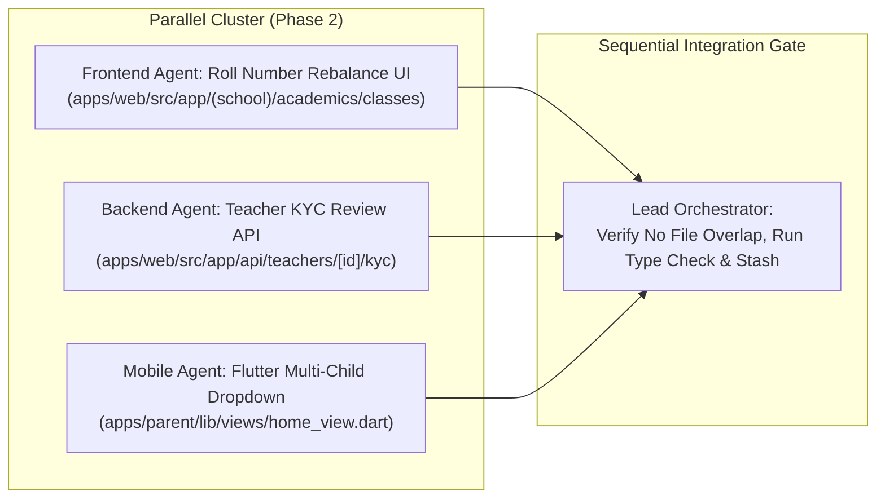

# RIVO — Execution Strategy & Engineering Methodology

> **Document:** `01_EXECUTION_STRATEGY.md`  
> **System:** RIVO School Management SaaS Execution Management System  
> **Authority:** CTO & Lead Orchestrator | **Version:** 1.0.0-EXEC  

---

## 1. Development Philosophy & Core Invariants

The Rivo execution methodology is built upon strict engineering discipline rather than ad-hoc AI code generation:

1. **Evidence Over Assumptions:** An AI agent must never assume code works because it compiles or because a mock returned `200 OK`. Every task requires objective verification (unit test, integration test, or database transaction check).
2. **Zero-Trust Multi-Tenancy:** Every database query touching tenant data MUST enforce `where: { schoolId }`. A missing `schoolId` filter is classified as an immediate P0 failure.
3. **Pessimistic Concurrency for Financial State:** Financial balances and sequence counters must never be computed or modified without transactional row locks (`FOR UPDATE`). In-memory balance updates in Node.js or mobile clients are strictly prohibited.
4. **Incremental, Reversible Changes:** Development proceeds in small, reviewable, single-responsibility units. Large sweeping refactors that touch multiple uncoordinated domains simultaneously are rejected.
5. **Separation of Execution and Planning:** Planning and architecture are codified in the Master Plan and Execution System. Agents execute tasks defined in [`TASK_REGISTRY.md`](file:///d:/Rivo/docs/PROJECT_MANAGEMENT/EXECUTION_SYSTEM/TASK_REGISTRY.md) and do not arbitrarily redefine product scope.

---

## 2. Phase-by-Phase Execution Framework

Development is organized into 10 structured phases:

```mermaid
flowchart TD
    P0["Phase 0: Security & Data Integrity Containment\n- Rotate DB Secrets\n- FOR UPDATE Locks on Fees\n- Fix Student Profile IDOR\n- Fail-Closed Rate Limiter"]
    P1["Phase 1: Shared Platform Foundation & Build Safety\n- Activate packages/types & validation\n- Strict TypeScript Build Check\n- Mount Root Toaster & Error Boundaries\n- Hermetic Local Test DB Runner"]
    P2["Phase 2: School Admin MVP Completion\n- Roll Number Rebalance Approval UI\n- Teacher KYC Verification Review Panel\n- Decompose monolithic school-store.ts"]
    P3["Phase 3: Parent Mobile App (Flutter) Completion\n- Multi-Child Switcher & Isolation\n- Fee Ledger & Installments View\n- Razorpay Gateway Checkout & PDF Receipt"]
    P4["Phase 4: Teacher Academic Portal & PWA\n- Mobile-First PWA Manifest\n- 1-Tap Classroom Attendance & SMS Alert\n- Offline IndexedDB Draft Sync & Marks Locking"]
    P5["Phase 5: Student Academic Experience\n- Secondary Student Web Portal (/student)\n- Persistent Homework Turn-in Database Models\n- Parent App K-8 Student Mode"]
    P6["Phase 6: Platform Admin & SaaS Operations\n- School Tenant Provisioning & Lifecycle\n- Subscription Quotas & Usage Billing\n- Audited Break-Glass Support Access"]
    P7["Phase 7: Public School Portal & Online Admission\n- Headless School Profile (/schools/[slug])\n- 4-Step Online Admission Funnel & Azure Upload"]
    P8["Phase 8: Cross-App Testing, SRE & Observability\n- Playwright Multi-App E2E Journeys\n- Load Testing & Query Optimization\n- Health Probes (/api/health/ready) & SRE Logging"]
    P9["Phase 9: Staging Validation & Production Launch\n- Pilot School Onboarding (1-3 Institutions)\n- App Store Distribution (Play Store / TestFlight)\n- Commercial Launch Sign-Off"]

    P0 --> P1 --> P2 --> P3 --> P4 --> P5 --> P6 --> P7 --> P8 --> P9
```



---

## 3. Sequential vs Parallel Work Management

To maximize engineering velocity without introducing race conditions or merge conflicts:

### Rules for Safe Parallel Work
1. **Domain Isolation:** Two agents may work concurrently ONLY if their assigned tasks touch mutually disjoint directories and database models (e.g., Parent Mobile Flutter App in `apps/parent/` and School Admin Timetable in `apps/web/src/app/(school)/timetable/`).
2. **Schema Lockdown:** Database schema modifications (`prisma/schema.prisma`) must execute sequentially. An agent modifying the schema acquires a virtual lock; all other agents must wait until the migration is deployed and validated.
3. **No Concurrent Edits to Shared Singletons:** Files like `apps/web/src/lib/prisma.ts`, `apps/web/src/app/layout.tsx`, and `apps/web/next.config.ts` must be edited by exactly one agent at a time.



---

## 4. Quality Gates & Acceptance Sequence

Every task must pass through five mandatory gates before being marked `COMPLETED`:

```
[READY] ──► [IN_PROGRESS] ──► [QUALITY GATES] ──► [VERIFIED] ──► [COMPLETED]
                                    │
               ┌────────────────────┼────────────────────┐
               ▼                    ▼                    ▼
        [1. Static Check]    [2. Security Gate]   [3. Functional Test]
        - npx tsc --noEmit   - No plain secrets   - Unit / Integration
        - ESLint / Oxlint    - Row-level scoping  - Real DB assertions
```

1. **Gate 1: Static Type & Lint Gate:** `npx tsc --noEmit` passes with zero errors; no `any` casts in API boundaries.
2. **Gate 2: Security & Tenant Isolation Gate:** Scoping by `schoolId` verified; no unmasked PII; timing-safe comparisons used.
3. **Gate 3: Functional & Transactional Gate:** Database transactions simulate concurrency; financial invariants hold; expected HTTP status codes returned.
4. **Gate 4: Evidence Documentation Gate:** Exact files changed, test terminal output, and reproduction proofs recorded in [`EXECUTION_LOG.md`](file:///d:/Rivo/docs/PROJECT_MANAGEMENT/EXECUTION_SYSTEM/EXECUTION_LOG.md).
5. **Gate 5: Non-Destructive Rollback Plan:** A defined git rollback commit or revert procedure exists for every merged unit.

---

## 5. Change Management & Scope Boundary Control

- **Scope Freezing:** The scope of the current phase is frozen in [`02_MASTER_PHASE_ROADMAP.md`](file:///d:/Rivo/docs/PROJECT_MANAGEMENT/EXECUTION_SYSTEM/02_MASTER_PHASE_ROADMAP.md). Agents are strictly forbidden from introducing unsolicited features, redesigning unrelated UI components, or adding unapproved third-party npm packages.
- **Scope Change Protocol:** If an agent discovers that a task requires an architectural or scope modification, it must submit an escalation report following [`BLOCKER_AND_ESCALATION_PROTOCOL.md`](file:///d:/Rivo/docs/PROJECT_MANAGEMENT/EXECUTION_SYSTEM/BLOCKER_AND_ESCALATION_PROTOCOL.md) and wait for the Project Owner's explicit approval.
- **Rollback Readiness:** Every task must document its rollback blast radius in [`TASK_REGISTRY.md`](file:///d:/Rivo/docs/PROJECT_MANAGEMENT/EXECUTION_SYSTEM/TASK_REGISTRY.md). If a task fails Gate 3 or Gate 4, the git working tree is immediately reverted to the pre-task checkpoint.
