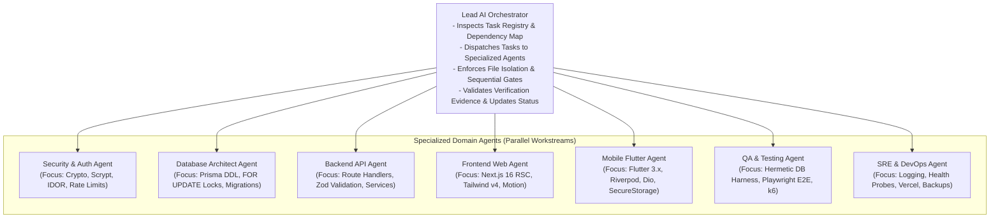

# RIVO — Multi-Agent Orchestration & Execution Protocol

> **Document:** `AGENT_ORCHESTRATION.md`  
> **System:** RIVO School Management SaaS Execution Management System  
> **Authority:** Lead AI Orchestrator & CTO | **Version:** 1.0.0-EXEC  

---

## 1. Orchestration Architecture & Agent Roster

To prevent chaotic cross-agent overwrites and maximize parallel development velocity, AI agents operate under a centralized command-and-control hierarchy:



---

## 2. Agent Responsibilities & Permitted File Boundaries

| Agent Role | Primary Expertise | Permitted Write Boundaries (Strict Enforcement) | Forbidden File Operations |
| :--- | :--- | :--- | :--- |
| **Lead Orchestrator** | Coordination, Verification, State Tracking | `docs/PROJECT_MANAGEMENT/EXECUTION_SYSTEM/*`, `git` commits | Direct application feature code edits without specialized delegation |
| **Security Agent** | OWASP ASVS, Scrypt, IDOR, Token Lifecycle | `apps/web/src/lib/auth/*`, `apps/web/src/middleware.ts`, `apps/web/.env.example` | Unrelated UI components or styling |
| **Database Agent** | Prisma ORM, ACID Transactions, Indexing | `prisma/schema.prisma`, `prisma/migrations/*`, `apps/web/src/lib/prisma.ts` | Mobile Flutter code or client React components |
| **Backend Agent** | Next.js API Routes, Services, Webhooks | `apps/web/src/app/api/*`, `apps/web/src/lib/*` (except auth & prisma singletons) | Mobile Dart files (`apps/parent/*`) |
| **Frontend Agent** | Next.js 16 RSC, UI Forms, Tailwind v4 | `apps/web/src/app/(school)/*`, `apps/web/src/app/(teacher)/*`, `apps/web/src/components/*` | Database DDL migrations or raw SQL locks |
| **Mobile Agent** | Flutter 3.x, Riverpod, Dio, Secure Storage | `apps/parent/*` (Dart, pubspec, iOS/Android native runners) | Any file inside `apps/web/*` or `prisma/*` |
| **QA Agent** | Test Pyramids, Hermetic Harnesses, E2E | `apps/web/src/__tests__/*`, `apps/web/e2e/*`, `tests/*` | Production business logic modification |
| **SRE Agent** | Telemetry, Health Probes, Infrastructure | `apps/web/src/lib/logger.ts`, `apps/web/src/app/api/health/*`, `.github/*` | Core financial calculation algorithms |

---

## 3. Mandatory Parallel Execution Rules

1. **Autonomous Boundary Check:** Before writing to any file, an agent must verify that the file falls strictly within its permitted write boundaries listed in Section 2.
2. **One Agent per File Rule:** Under no circumstances may two agents edit the same file simultaneously. If Task B requires modifying a file currently locked by Task A, Task B must be marked `BLOCKED` until Task A is verified and committed.
3. **Clean Git Branching / Atomic Commits:** Each completed task must be committed as a clean, single-responsibility git commit with reference to its task ID:
   ```text
   feat(fees): implement pessimistic FOR UPDATE locks in payment allocation (RIVO-SEC-002)
   ```
4. **No Destructive Overwrites:** An agent must never delete or blindly overwrite existing working code. Edits must be targeted using surgical drop-in replacements.
5. **Simulated vs Real Parallelism Transparency:** If the execution environment does not support true background subagents, the Lead Orchestrator must execute tasks sequentially, explicitly recording sequential execution rather than falsely claiming concurrency.

---

## 4. Standardized Agent Reporting Protocol

Every agent must report its progress back to the Lead Orchestrator using this exact 10-point Markdown format:

```markdown
### AGENT EXECUTION REPORT: [TASK_ID]
- **Agent Role:** [e.g. Backend Agent]
- **Task Title:** [e.g. Enforce Object-Level Auth on Student Profile]
- **Execution Status:** [VERIFIED / BLOCKED / FAILED]
- **Files Created / Modified:**
  - `apps/web/src/app/api/students/[id]/route.ts` (Lines 14-60)
- **Work Completed:** [Detailed summary of architectural changes]
- **Verification Evidence:**
  - Command: `npm run test:auth`
  - Output: `✓ PASS: Teacher A forbidden from viewing Student B in Class 10`
- **Dependencies Encountered:** [Any downstream interactions]
- **Blockers / Risks:** [None or detailed blocker description]
- **Git Commit Hash:** [e.g. 7f3a9b1]
- **Recommended Next Action:** [e.g. Proceed to RIVO-ADM-001]
```

The Lead Orchestrator reviews the report, verifies test evidence, updates [`TASK_REGISTRY.md`](file:///d:/Rivo/docs/PROJECT_MANAGEMENT/EXECUTION_SYSTEM/TASK_REGISTRY.md) and [`PROGRESS_TRACKER.md`](file:///d:/Rivo/docs/PROJECT_MANAGEMENT/EXECUTION_SYSTEM/PROGRESS_TRACKER.md), and transitions the task to `COMPLETED`.

