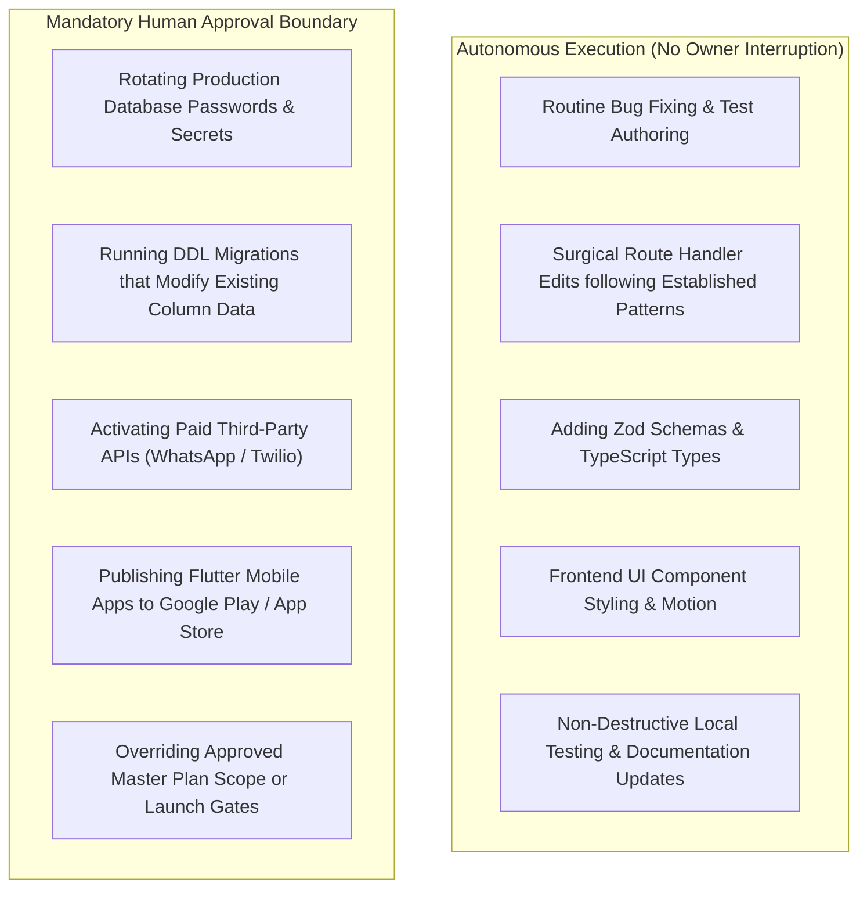

# RIVO — Blocker Detection & Human Escalation Protocol

> **Document:** `BLOCKER_AND_ESCALATION_PROTOCOL.md`  
> **System:** RIVO School Management SaaS Execution Management System  
> **Authority:** CTO & Lead Orchestrator | **Version:** 1.0.0-EXEC  

---

## 1. When Agents Must Stop and Escalate

AI agents operate autonomously within approved engineering standards, but MUST immediately halt work and escalate to the Project Owner under any of the following 10 mandatory conditions:

1. **Missing or Expired Secrets:** An external API key, live payment gateway credential, or database password is required but missing or unverified. (Never invent fake keys).
2. **Destructive Schema Migration Risk:** A proposed database migration would drop existing tables, alter existing column types with potential data loss, or truncate data.
3. **Architecture / Code Contradiction:** Source code directly contradicts approved architectural decisions codified in `RIVO_ENTERPRISE_READINESS_MASTER_PLAN.md`.
4. **Cross-Tenant Isolation Breach:** A discovered query or pattern leaks data across schools, requiring an immediate architectural fix.
5. **Repeated Test Failure:** An agent fails three consecutive attempts to pass an established verification gate.
6. **Paid Cloud Ingress Trigger:** A task requires purchasing a paid tier, enabling a third-party paid API (e.g. Meta WhatsApp Cloud API), or provisioning billable cloud hardware.
7. **Production Deployment / Data Mutation:** Any action intending to deploy to Vercel production or run DDL against the live production PostgreSQL database.
8. **Scope Creep / Unsolicited Redesign:** A requested modification significantly expands MVP scope beyond the 10 defined roadmap phases.
9. **Unresolved Third-Party Dependency Outage:** A critical dependency (Neon, Upstash, Vercel, npm) experiences an active outage preventing task completion.
10. **Legal & Compliance Ambiguity:** A feature touches child data consent (DPDP Act 2023) or financial accounting rules without clear statutory guidance.

---

## 2. Standardized 7-Point Blocker Escalation Template

When an agent hits a blocker, it must emit a standardized escalation report formatted as follows:

```markdown
🚨 =========================================================================
   RIVO FORMAL BLOCKER ESCALATION: [BLOCKER_ID]
   =========================================================================

1. WHAT HAPPENED?
   [Clear, factual summary of the obstacle encountered]

2. WHICH TASK IS AFFECTED?
   [Task ID e.g. RIVO-SEC-001, Module Name, Current Status: BLOCKED]

3. WHY IS WORK BLOCKED?
   [Exact root cause: missing secret, failing gate, architectural contradiction]

4. WHAT HAS ALREADY BEEN INVESTIGATED?
   [File paths checked, commands executed, and diagnostic outputs]

5. WHAT ARE THE AVAILABLE TECHNICAL SOLUTIONS?
   - Option A: [Description, trade-offs, effort]
   - Option B: [Description, trade-offs, effort]

6. WHAT DOES THE LEAD ORCHESTRATOR RECOMMEND?
   [Specific recommendation with justification]

7. WHAT DECISION OR ACTION IS REQUIRED FROM THE PROJECT OWNER?
   [Direct question or exact action needed, e.g. "Please rotate Neon password and reply with confirmation"]
=========================================================================
```

---

## 3. Autonomous Execution vs Human Owner Approval Boundary



- **Rule of Thumb:** If an action is reversible, non-destructive, and stays within local file boundaries, execute autonomously. If an action affects production data, incurs external financial cost, or alters security boundaries, require human owner sign-off.

