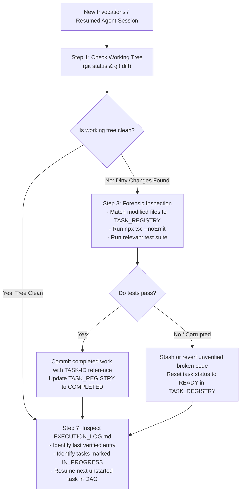

# RIVO — Checkpoint & Session Recovery Protocol

> **Document:** `CHECKPOINT_AND_RECOVERY_PROTOCOL.md`  
> **System:** RIVO School Management SaaS Execution Management System  
> **Authority:** Lead Orchestrator & CTO | **Version:** 1.0.0-EXEC  

---

## 1. Formal Milestone Checkpoint Protocol

At the completion of each phase or major milestone, the Lead Orchestrator executes a formal Checkpoint Verification:

```
┌─────────────────────────────────────────────────────────────────────────────┐
│                       CHECKPOINT VERIFICATION CADENCE                       │
├─────────────────────────────────────────────────────────────────────────────┤
│ 1. Git Tree Audit:      Verify zero uncommitted dirty changes in workspace. │
│ 2. Task Registry Sync:  Confirm every finished task marked VERIFIED.        │
│ 3. Automated Test Run:  Execute full test suite; confirm zero regressions.  │
│ 4. Git Tag Creation:    Tag commit e.g. 'checkpoint-phase-0-complete'.      │
│ 5. Progress Recalculate:Update PROGRESS_TRACKER.md with verified metrics.   │
│ 6. Append Log Record:   Write formal Checkpoint Record to EXECUTION_LOG.md. │
└─────────────────────────────────────────────────────────────────────────────┘
```

---

## 2. Recovery from Crashed, Stalled, or Restarted Agent Sessions

When an AI agent session is interrupted, restarted, or crashes mid-task (such as the server restart observed in conversation logs):



### Forensic Recovery Steps:
1. **Inspect Working Tree:** Run `git status`. Do not blindly run `git reset --hard`.
2. **Inspect Task Registry:** Identify any task left in `IN_PROGRESS`.
3. **Validate Partial Changes:**
   - If changes compile and pass tests: complete the verification checklist and commit.
   - If changes are broken or half-written: revert the specific file to pre-task state (`git restore <file>`) and reset task to `READY`.
4. **Log the Recovery:** Record a `[SESSION RECOVERY]` entry in [`EXECUTION_LOG.md`](file:///d:/Rivo/docs/PROJECT_MANAGEMENT/EXECUTION_SYSTEM/EXECUTION_LOG.md).
