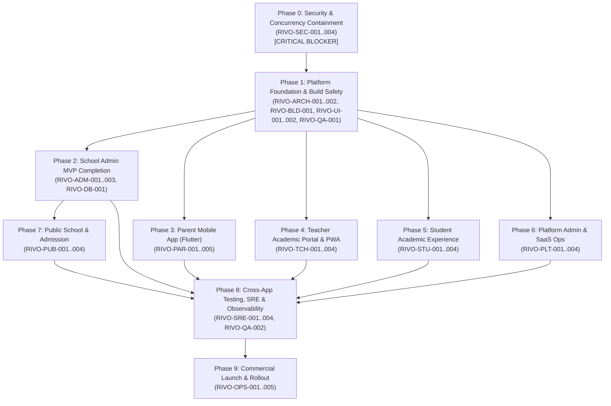
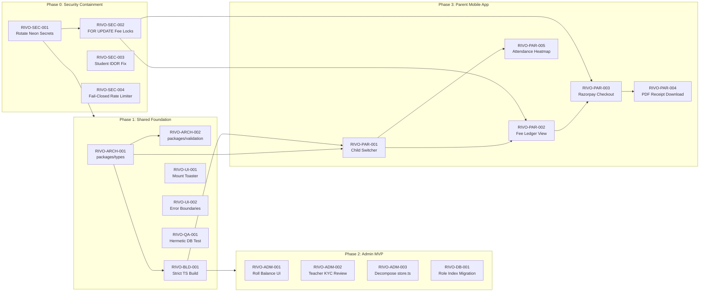

# RIVO — Task & Module Dependency Map

> **Document:** `DEPENDENCY_MAP.md`  
> **System:** RIVO School Management SaaS Execution Management System  
> **Authority:** CTO & Lead Orchestrator | **Version:** 1.0.0-EXEC  

---

## 1. High-Level Phase Dependency DAG



---

## 2. Granular Task-Level Dependency DAG



---

## 3. Parallel Execution Clusters vs Sequential Bottlenecks

### Fully Parallelizable Clusters (Zero File Overlap)
1. **Cluster 0-A (Phase 0):**
   - Agent 1: `RIVO-SEC-002` (Modifies `apps/web/src/lib/fees/fee-payment-service.ts`)
   - Agent 2: `RIVO-SEC-003` (Modifies `apps/web/src/app/api/students/[id]/route.ts`)
   - Agent 3: `RIVO-SEC-004` (Modifies `apps/web/src/lib/auth/rate-limiter.ts`)
   *Verdict: Safe to execute concurrently. Mutually disjoint files.*

2. **Cluster 1-A (Phase 1):**
   - Agent 1: `RIVO-ARCH-001` (Modifies `packages/types/`)
   - Agent 2: `RIVO-UI-001` (Modifies `apps/web/src/app/layout.tsx`)
   - Agent 3: `RIVO-UI-002` (Creates `apps/web/src/app/error.tsx` & `not-found.tsx`)
   *Verdict: Safe to execute concurrently.*

3. **Cluster Cross-Surface (Phase 2 & Phase 3):**
   - Agent 1 (Web): `RIVO-ADM-001` (Modifies `apps/web/src/app/(school)/academics/classes`)
   - Agent 2 (Mobile): `RIVO-PAR-001` (Modifies `apps/parent/lib/views/home_view.dart`)
   - Agent 3 (Backend): `RIVO-ADM-002` (Modifies `apps/web/src/app/api/teachers/[id]/kyc`)
   *Verdict: 100% independent workspaces. Zero risk of collision.*

### Strict Sequential Bottlenecks (Must Wait)
1. **The Secret Rotation Bottleneck:** `RIVO-SEC-001` must complete before any code is committed or pushed to remote repositories.
2. **The Concurrency Lock Bottleneck:** `RIVO-SEC-002` (Database `FOR UPDATE` locks) must complete before `RIVO-PAR-003` (Parent Mobile Payment Gateway Checkout) can be tested.
3. **The Strict Build Bottleneck:** `RIVO-BLD-001` (`ignoreBuildErrors: false`) must complete before any E2E tests in Phase 8 can run in CI.

---

## 4. Shared Files & Resource Conflict Map

The following files represent high-contention resources that must NEVER be edited by multiple agents simultaneously:

| High-Contention Resource | Allowed Modifying Tasks | Locking & Access Rule |
| :--- | :--- | :--- |
| `prisma/schema.prisma` | `RIVO-DB-001`, `RIVO-STU-001`, `RIVO-PLT-001`, `RIVO-PUB-001` | Sequential exclusive lock. Must run `npm run prisma:validate` before releasing lock. |
| `apps/web/src/app/layout.tsx` | `RIVO-UI-001` | One-time exclusive edit. No other task should touch root layout. |
| `apps/web/next.config.ts` | `RIVO-BLD-001` | One-time exclusive edit. Verified by `npm run build`. |
| `apps/web/src/lib/fees/fee-payment-service.ts`| `RIVO-SEC-002`, `RIVO-PAR-003` | Sequential. Concurrency locks must be committed before webhook integration. |
| `apps/parent/lib/core/api_client.dart` | `RIVO-PAR-001`, `RIVO-PAR-004` | Sequential edit within mobile agent workstream. |

---

## 5. Critical Path Analysis

The critical path dictating the minimum delivery timeline (90 engineering days) is:

```
[RIVO-SEC-001: Secrets] ──► [RIVO-SEC-002: Fee Locks] ──► [RIVO-BLD-001: Strict Build]
                                                                     │
[RIVO-PAR-004: Receipts] ◄── [RIVO-PAR-003: Razorpay] ◄── [RIVO-PAR-001: Multi-Child]
         │
         ▼
[RIVO-QA-002: Cross-App E2E] ──► [RIVO-OPS-001: Release RC] ──► [RIVO-OPS-005: Launch]
```

Total critical path duration cannot be compressed below 45 calendar days even with unlimited parallel agents due to sequential database verification, app store review lead times, and real pilot school operational cycles.

