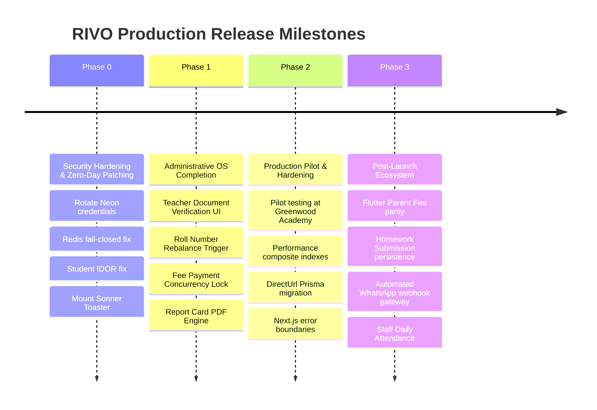

# Implementation Roadmap & Milestone Strategy

> **Last Verified:** November 11, 2026  
> **Status:** Code-Verified Milestones  
> **Target:** Path to Production Launch

---

## 1. Milestone Roadmap

---

## 2. Milestone Deliverables

### Milestone 0: Security & Quality Hardening (Immediate P0)
- **Goal:** Eliminate security risks, prevent credential leaks, and fix silent UI errors.
- **Deliverables:**
  1. Rotate Neon PostgreSQL credentials and cleanse `.env.example` templates.
  2. Fix `RateLimiter` to fail-closed in production mode when Redis is unreachable.
  3. Patch IDOR in `GET /api/students/[id]` to enforce `ASSIGNED` scope for teachers.
  4. Fix Cartesian product query in `GET /api/students`.
  5. Mount `<Toaster />` in `apps/web/src/app/layout.tsx`.

### Milestone 1: School Admin OS Completion (Launch Readiness)
- **Goal:** Close all open UI workflow gaps on the school management side.
- **Deliverables:**
  1. Add "Documents & Verification" review tab to `apps/web/src/app/(school)/school/teachers/[id]/page.tsx`.
  2. Add "Rebalance Roll Numbers" confirmation dialog to `/school/students`.
  3. Implement server-side report card PDF generation service via `pdf-lib` modeled after `fee-pdf-service.ts`.
  4. Add distributed Redis mutex lock (`redlock`) around `recordFeePayment`.
  5. Invalidate Redis session cache in `/api/auth/parent/select-school`.

### Milestone 2: Production Pilot & Stabilization
- **Goal:** Deploy production pilot for initial customer schools on Vercel.
- **Deliverables:**
  1. Add `directUrl = env("DIRECT_URL")` to `prisma/schema.prisma`.
  2. Remove `typescript: { ignoreBuildErrors: true }` from `apps/web/next.config.ts`.
  3. Add standard `error.tsx` and `not-found.tsx` boundaries across route groups.
  4. Add missing standalone indexes on audit foreign keys (`collectedByUserId`, `verifiedById`).

### Milestone 3: Ecosystem Expansion (Post-Launch Phase)
- **Goal:** Expand parent mobile app and coursework turn-in.
- **Deliverables:**
  1. Implement `fees_view.dart` in `apps/parent` for mobile fee statements and receipt downloads.
  2. Add `HomeworkSubmission` model to PostgreSQL for digital homework turn-in.
  3. Evaluate Twilio / Meta WhatsApp Business automated notification gateway.

