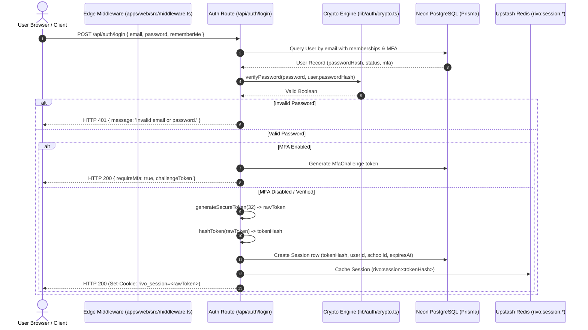
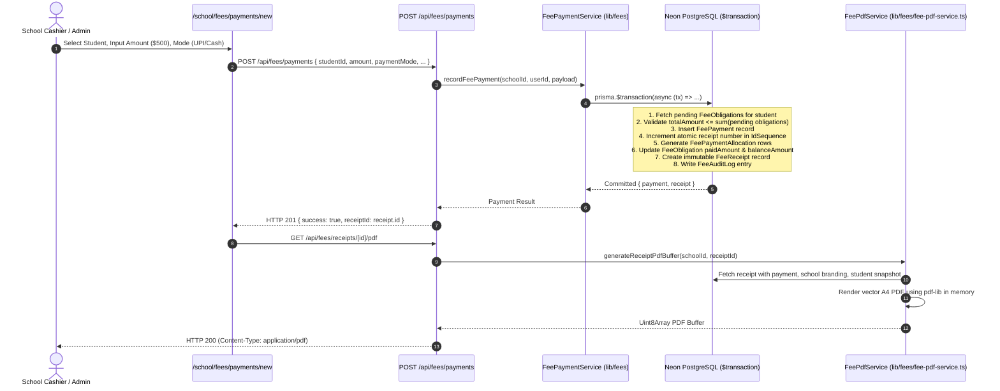
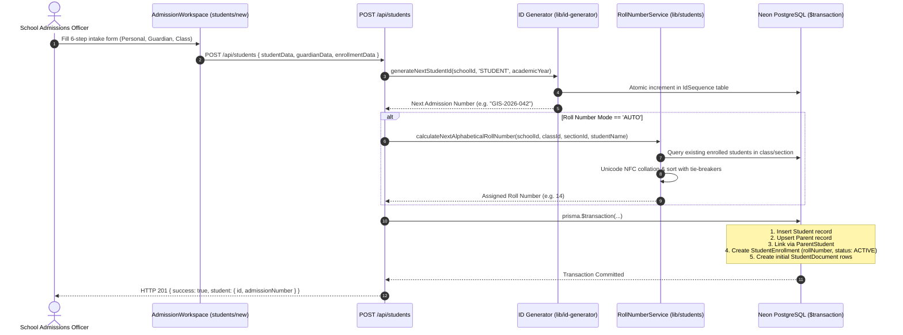
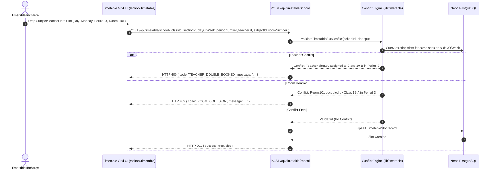
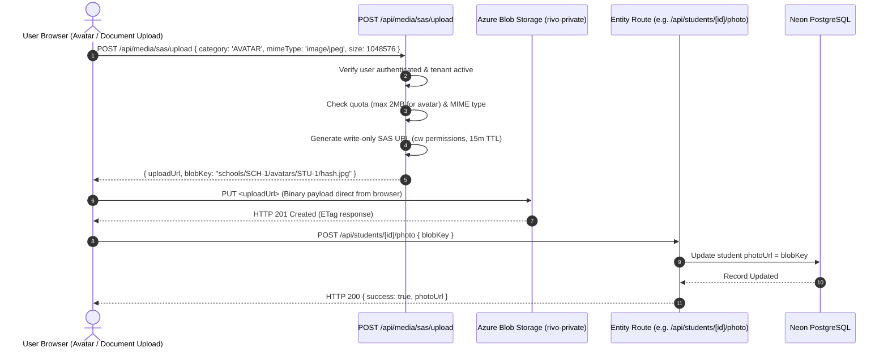

# RIVO — System Data Flow Architecture

> **Last Verified:** November 11, 2026  
> **Status:** Code-Verified Data Lifecycle  
> **Scope:** End-to-End Tracing Across UI, API, Business Services, and Datastores

---

## 1. Authentication & Session Resolution Flow

---

## 2. Fee Collection & Instant Receipt PDF Flow

---

## 3. Student Admission & Roll Number Balancing Flow

---

## 4. Timetable Clash Validation Flow

---

## 5. Direct-to-Cloud Media Upload Flow

